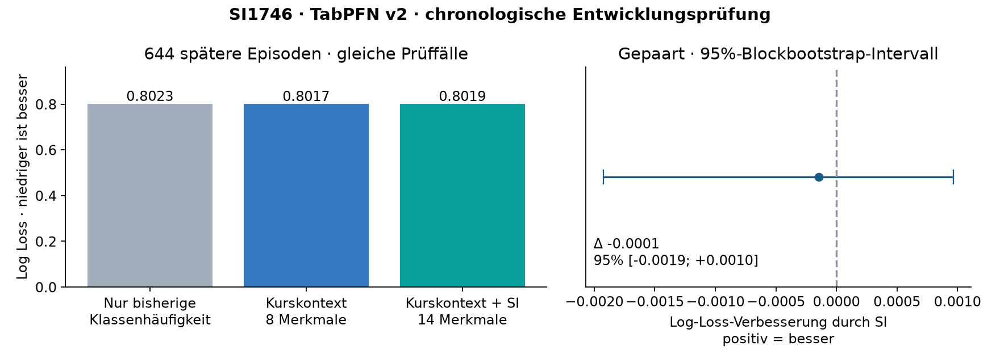

# SI1746 · TabPFN v2 · 21. November 2026

Kein belastbarer zusätzlicher Prognosevorteil durch SI in diesem Vergleich.

Alle1746 archivierten RITHMIC-Meldungen aus ES229/NQ907/GC208/CL402 wurden geprüft.
Exakte Kontrakte:361 Quote-Parquetdateien,1.884.326.582Bytes per SHA256 gegen die
Importprotokolle geprüft; native Nautilus-Dekodierung von2968 skalaren Werten.
1635 Meldungen haben gültige 15min-Labels,111 bleiben mit Ausschlussgrund erhalten.
Die1019 überlappungsfreien Episoden ergeben936 gültige erste Meldungen.
43 der45 vor den Labels eingefrorenen Kontrollpaare haben beidseitig gültige Labels.

Tatsächlich abgeschlossen: zwei TabPFNv2-Arme, jeweils8 chronologische Fits;
644 spätere Prüfepisoden an71 Tagen,
2026-07-23 bis2026-10-30. Erste40 Handelstage Training,
eine ganze Tageslücke, danach10-Tagesblöcke. Früher geprüfte Daten dürfen in späteren
Fits als inzwischen bekannte Vergangenheit eingehen. Kein Zufallssplit.

| Gleiche Prüffälle | Log Loss ↓ | Brier ↓ | Trefferquote | Balancierte Trefferquote |
|---|---:|---:|---:|---:|
| Trainingshäufigkeiten | 0.802277 | 0.525566 | 52.48% | 33.33% |
| Nur Kurskontext | 0.801713 | 0.526364 | 51.55% | 32.95% |
| Kurskontext + SI | 0.801860 | 0.526466 | 51.40% | 32.76% |

Primär: LogLoss(Kurs)−LogLoss(Kurs+SI)=-0.000147;95%-Intervall
[-0.001925;+0.000966],1999 bewegliche Fünftages-Blockbootstrap-Züge.
Die Unsicherheit gilt bedingt auf diese Fits/Entwicklungsdaten; keine universelle
Signifikanz oder unberührte Bestätigung. Makro-Gleichgewicht der Märkte zusätzlich
in results.json; NQ dominiert die gepoolte Anzahl.

Ziel:LONG/SHORT/FLAT nach15Minuten, anhand ausführbarer Bid/Ask-Seiten und des
eingefrorenen Forschungsgebührenmodells. Ausgabe sind hypothetische Quote-Markouts,
keine Orders, HY-Entries, Prop-Kontoverläufe oder Auszahlungen. Die Flach-Klasse
bedeutet,dass weder Long noch Short nach Spread/Gebühren positiv ist; Trefferquote
allein ist wegen ungleicher Klassen nicht die primäre Kennzahl.

Kursmerkmale: Markt,Chicago-Minute,Bewegung60s/300s relativ zur vergangenen RV,
RV in Ticks,Spread,Top-Size-Imbalance,Quotealter. SI zusätzlich:Typ,Bot-Pfeil,
Menge,Faktor,Zonenbreite und gerichteter Zonenabstand. Keine Zukunftsextrema,
Original-Erkennungszeit,echte aggressive Kauf-/Verkaufsseite oder Feed-Vollständigkeit
behauptet. Entscheidungszeit=Discord-Verfügbarkeit+30s. Archivbracketing und enge
Kaliper liefern wenige Kontrollen; Kontrollen sind keine bewiesenen Nicht-SI-Zeiten.
Der primäre Modellvergleich prüft die sechs zusätzlichen Meldungsattribute an
SI-Zeitpunkten. Er isoliert nicht den Nutzen der bloßen Existenz einer Meldung
gegenüber garantiert meldungsfreien Marktphasen. Beide Arme wissen durch die
Fallauswahl indirekt,dass es ein archivierter Meldungszeitpunkt ist.

80 nach Markt/Zeit geschichtete physische Zukunftsabschneidungen,8 Designprüfungen,
exakte Float64-Parität der CSV-Transportmerkmale mit Parquet sowie native
Kontraktspezifikationen geprüft. Der erste Aufruf stoppte vor dem Fit wegen fehlendem
Arrow-Leser im TabPFN-Environment; unveränderte Fälle/Klassen/Modelle über geprüften
CSV-Transport. Optional fehlende Nanosekundenwerte werden als nullable Int64
gespeichert. Erster Fehler und Korrekturbeleg bleiben erhalten.

Versuchsplan vor Labels/Fits auf GitHub:Commit3ed9deeaf715391bebc22559e90f8d2ff7accac3.
Alle privaten Ereigniszeilen/Kursquotes/IDs bleiben lokal. Quellen/Parameter,
aggregierte Belege und Ergebnisse sind öffentlich dokumentiert; Dateien in Private
nicht hochladen. Ausführen aus dem ursprünglichen outputs/SI-TabPFN-Pool-20261121/
Unterprojekt (Source/common.py leitet den Workspace dort relativ ab).

MLflow: http://127.0.0.1:5055/#/experiments/4
Kurslauf:9864ca90541745989eb4d4c4c0ab2340
SI-Lauf:c804315311d541689f83ccc5e17aea82

Built with PriorLabs-TabPFN. Offizielles lokales v2-Modell,CPU,4Estimatoren,
Seed20261121,kein Fine-Tuning großer Gewichte/keine Cloudaufrufe/keine Käufe.
Bestehende Strategien,Sims,Leaderboards und deren Geldzahlen unverändert.

